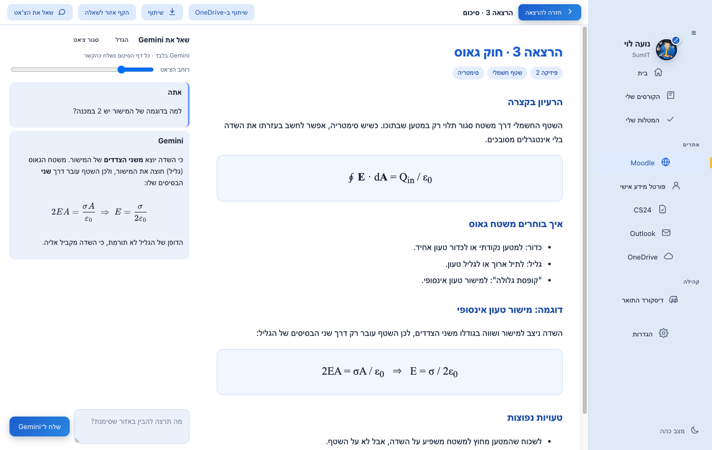
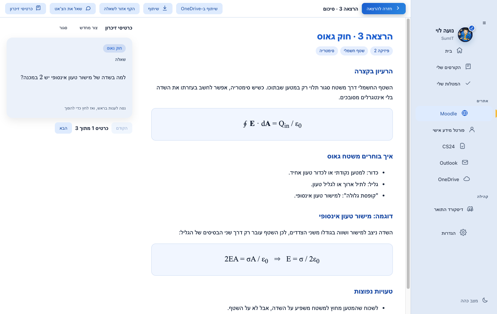
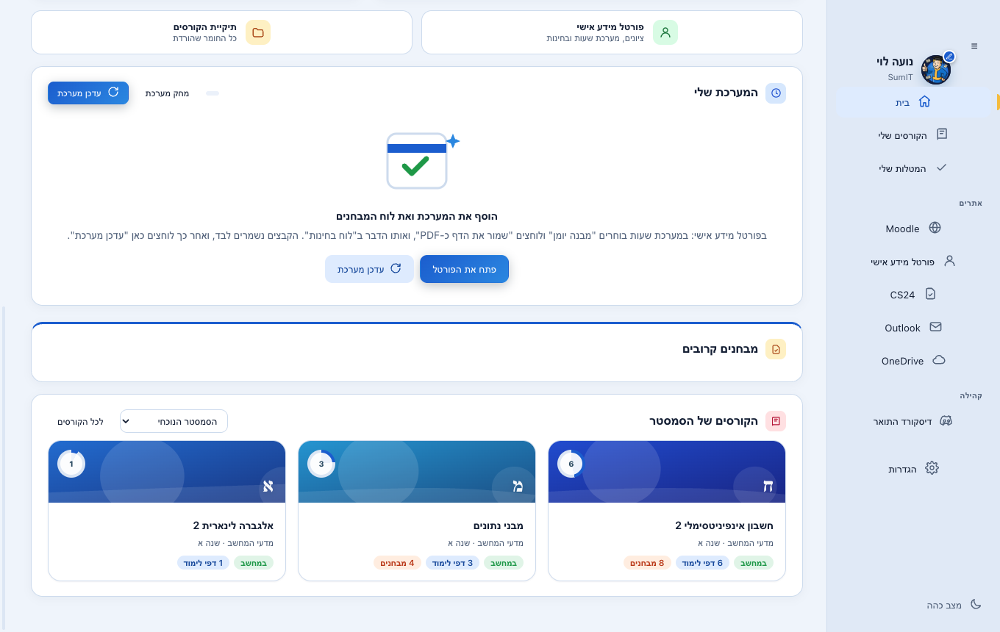
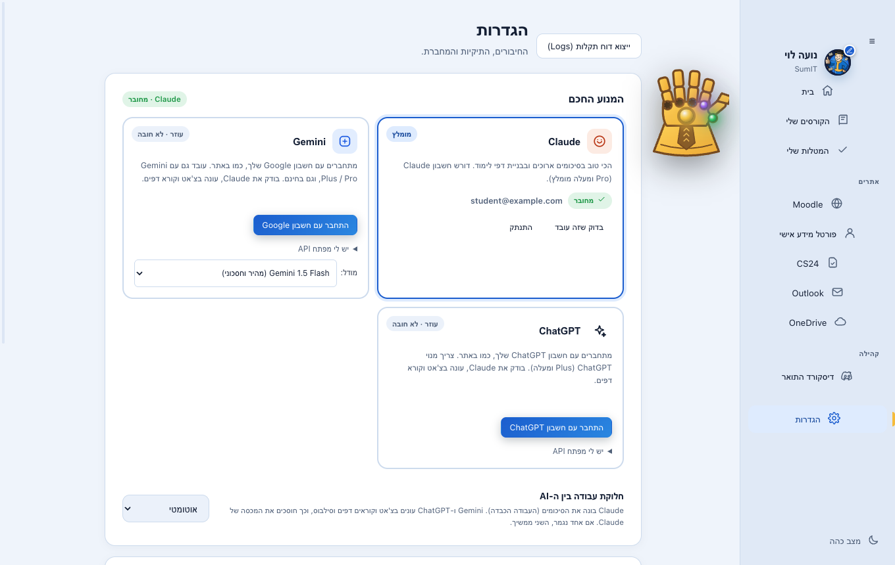

<div dir="rtl" align="center">


# SumIT

**אחרי כל הרצאה: מכניסים את החומר, ומקבלים סיכום מלא עם שיעורי הבית.**

אפליקציה ל-Windows ול-macOS לסטודנטים ב-HIT. היא מחברת את Moodle, Zoom ו-CS24, ובונה לכל הרצאה סיכום מסודר שמסביר גם איך לפתור את שיעורי הבית, לפי איך שהמרצה שלך חושב.


</div>

> **SumIT 1.0.20 ל-macOS** - חדש: **כרטיסי זיכרון** מכל סיכום, **צ'אט על הסיכום שעונה תוך כדי כתיבה** (בערך פי 2 מהר יותר) ונפתח ליד הסיכום, **רק הקורסים של הסמסטר** בדף הבית, כפתור **דיסקורד התואר** שנפתח ישר באפליקציית Discord, ו**כפפת האינסוף** שחוזרת להגדרות. בנוסף, אתרים בתוך האפליקציה לא מכסים יותר את הסרגל במק בעברית. [מה השתנה](docs/release-1.0.20.md)
>
> **SumIT 1.0.14** - **תמיכה מלאה וטבעית ב-macOS (Apple Silicon & Intel)**, בורר מודלים מותאם ומנגנון גיבוי אוטומטי במקרה של עומס ל-Gemini, ייצוא סיכומים לקובץ ZIP לשיתוף, צ'אט מובנה על הסיכום מול Gemini, עיצוב בכחול וזהב, עמוד "המטלות שלי", טעינת המערכת והמבחנים בלחיצה, וסיכומים מודרכים.

<div dir="rtl">

## איך זה עובד

1. **יוצרים את ההרצאה** - כפתור אחד, והיא מקבלת תיקייה משלה ותאריך (לפי המערכת שלך והחגים).
2. **מכניסים את החומר** - מצגות ושיעורי בית מ-Moodle, חומר מ-CS24, קבצים מהמחשב, קישור להקלטת Zoom. מחברת (Notability או אחרת) שומרים כ-PDF בתיקייה של ההרצאה והאפליקציה מזהה אותה לבד.
3. **לוחצים "צור סיכום"** - ומקבלים סיכום של כל ההרצאה, ואחריו שיעורי הבית: לכל שאלה לאיזה חלק בסיכום היא קשורה, איך מתחילים אותה, ואיך המרצה מצפה שיענו. הסיכום נפתח בתוך האפליקציה, ויש גם קובץ PDF.

כל הרצאה נבנית על הקודמות: הסיכום של הרצאה 3 מכיר את החומר של 1 ו-2.

<div align="center">

</div>

### לפני הרצאה 1: מבחנים משנים קודמות

האפליקציה מורידה בלחיצה אחת את כל המבחנים והפתרונות מה-Moodle של הקורס (או מ-CS24, או מהמחשב). כך היא רואה אילו שאלות המרצה שואל ואיך הוא עונה עליהן, וזה משפר כל סיכום שנבנה אחר כך. בלשונית "מידע על הקורס" לחיצה אחת מורידה את הסילבוס וקוראת אותו.

<div align="center">

</div>

### בזמן שהסיכום נבנה

סרגל עם אחוזים וזמן משוער (לפי כמה זמן לקחו הסיכומים הקודמים), וההתקדמות נשמרת גם אם עוברים למסך אחר וחוזרים. סיכום לוקח כמה דקות. עדיף לחכות ולקבל משהו טוב.

<div align="center">

</div>

### שאלה על הסיכום

בסיכום של הרצאה לוחצים **"שאל את הצ'אט"**: הצ'אט נפתח משמאל, הסיכום נשאר באמצע והתפריט בימין. Gemini מקבל את כל הסיכום, את שם הקורס ואת שם ההרצאה, והתשובה מופיעה מילה אחרי מילה בזמן שהיא נכתבת. עם **"הקף אזור לשאלה"** אפשר לסמן נוסחה או שרטוט ולשאול עליהם. את רוחב הצ'אט משנים עם הסרגל שבראש הצ'אט.

<div align="center">

</div>

### כרטיסי זיכרון (macOS)

בסיכום של הרצאה לוחצים **"כרטיסי זיכרון"**, ו-Gemini מכין מהסיכום כרטיסים לתרגול בשלושה שלבים: מחלץ את הנוסחאות וההגדרות המרכזיות, כותב מהן שאלות בסגנון מבחן, ובודק את התשובות מול הסיכום. לוחצים על כרטיס כדי להפוך אותו מהשאלה לתשובה, ועוברים בין כרטיסים עם "הקודם" ו"הבא" (או עם החיצים). ההכנה לוקחת בערך חצי דקה. הכרטיסים נשמרים ליד הסיכום ונפתחים מיד בפעם הבאה, ו"צור מחדש" מכין סט חדש.

<div align="center">

</div>

### בחירת קבצים מהאתרים

Moodle, הפורטל, CS24, **Outlook** ו-**OneDrive של HIT** נפתחים בתוך האפליקציה (בתפריט הצד). מעל האתר רואים לאן כל קובץ נשמר (הקורס, ההרצאה, מצגות או שיעורי בית), יש אחוזי הורדה, כפתור "שמור את הדף כ-PDF", וכפתורי חזרה לקורס ולדף הקודם. כשנכנסים להקלטת Zoom האפליקציה מציעה להוריד אותה להרצאה. כפתורי ה-Moodle בהרצאה פותחים ישר את הדף של הקורס, והכפתור נצבע בירוק אחרי שהורדת משם חומר.

בהרצאה אפשר להוסיף הקלטה גם מהמחשב (ותמלול, אם יש), לא רק מקישור.

### המערכת שלך

טבלה שבועית עם כל השעות, ומתחתיה המבחנים הקרובים. איך טוענים אותה:

1. נכנסים לפורטל (בתוך האפליקציה) ובמערכת שעות בוחרים **"מבנה יומן"**, ולוחצים למעלה **"שמור את הדף כ-PDF"**.
2. ב**"לוח בחינות"** לוחצים שוב "שמור את הדף כ-PDF".
3. בדף הבית לוחצים **"עדכן מערכת"**. הקבצים נשמרים לבד בתיקייה "מערכת שעות" בתוך HIT, והאפליקציה קוראת מהם את המערכת, המבחנים והחגים (ומציעה תאריך לכל הרצאה). יש גם כפתור **"מחק מערכת"** להתחלה מחדש.

<div align="center">

</div>

### הקורסים של הסמסטר

בדף הבית מופיעים רק הקורסים של הסמסטר הנוכחי, לפי הסמסטר שבשם הקורס ב-Moodle (למשל "תשפז_א") ולפי הקורסים שהגדרת באפליקציה. Moodle משאיר קורסים ישנים "בתהליך" כשאין להם תאריך סיום, ולכן בלי הסינון הופיע כל מאגר הקורסים. בתפריט שליד הכותרת אפשר לעבור ל**"כל הקורסים הפעילים"**, והבחירה נשמרת.

<div align="center">

</div>

### דיסקורד התואר

הכפתור **"דיסקורד התואר"** בתפריט הצד פותח את שרת הדיסקורד של התואר. אם Discord מותקן במחשב, השרת נפתח ישר באפליקציה, ואם לא, בדפדפן. את הקישור לשרת אפשר להחליף בהגדרות.

### המטלות שלי והפרופיל

בתפריט הצד: **המטלות שלי** - מטלות שמוסיפים בעצמם (הגשות, הכנות למבחן), עם קורס ותאריך, מחולקות ל"עבר המועד", "השבוע" ו"בהמשך". בלחיצה על העט שעל התמונה למעלה מגדירים שם, תיאור קצר ותמונה אישית.

<div align="center">
 
</div>

## כמה AI עובדים ביחד

| | תפקיד | חיבור |
|---|---|---|
| **Claude** | בונה את הסיכומים (העבודה הכבדה: קורא קבצים ויוצר דפים) | חשבון Claude (Pro ומעלה מומלץ). האפליקציה מתקינה ומחברת |
| **Gemini** | בודק את הסיכום ואת הפתרונות של Claude, עונה בצ'אט, קורא מערכת וסילבוס | מתחברים עם חשבון Google (חינמי או Gemini Plus/Pro), דרך Antigravity CLI של Google, בלי מפתח |
| **ChatGPT** | אותו דבר, כעוזר נוסף | מתחברים עם חשבון ChatGPT (מנוי Plus ומעלה), בלי מפתח |

ב**הגדרות** בוחרים את החשבון שרוצים לחבר. מסלול ההתחברות משתנה לפי הספק; ב-Gemini עשוי להיפתח גם חלון מסוף, כמפורט בהמשך (האפליקציה לא רואה את הסיסמה). Claude כותב את הסיכום והפתרונות, ו-AI אחר בודק אותם ומוסיף הערות בסוף הסיכום (כפתור "בדיקה שנייה עם AI נוסף"). בצ'אט, מתחת לכל תשובה, אפשר ללחוץ "בדוק עם AI נוסף" כדי שהשני יאשר או יתקן. אם אחד נגמר, הבא ממשיך, ובהגדרות בוחרים מי קודם או "רק Claude". Gemini ו-ChatGPT לא חובה. **סטודנט שיש לו רק Gemini (למשל Gemini Plus) מקבל את הסיכומים מ-Gemini**: האפליקציה מתאימה את עצמה למה שמחובר, ו-Claude הוא בונוס.

<div align="center">

</div>

### התחברות ל-Gemini עם חשבון Google

ההוראות מתייחסות לגרסת ההשקה **SumIT 1.0**. [להורדת האפליקציה ל-Windows](https://github.com/Pinkel-Kinkel/SumIT/releases/latest).

1. פותחים **הגדרות → Gemini → התחבר עם חשבון Google**.
2. נפתח חלון מסוף (CMD / Windows Terminal) של **Google Antigravity**, הכלי הרשמי שבו האפליקציה משתמשת לחיבור החשבון. פתיחת החלון היא חלק מההתחברות, לא תקלה.
3. בוחרים התחברות עם Google ופועלים לפי ההוראות שבחלון. אם מוצג קישור במקום שהדפדפן ייפתח, פותחים אותו בדפדפן ונכנסים לחשבון.
4. **אם הדפדפן מציג קוד אישור, מעתיקים ומדביקים אותו בחלון המסוף שממנו התחילה ההתחברות, ולוחצים Enter.** אין להדביק אותו בצ'אט של הקורס או בשדה של מפתח API, ואין לשתף אותו עם אחרים. אם ההתחברות מסתיימת אוטומטית, אין צורך בקוד.
5. משאירים את החלון פתוח עד לסיום האישור. SumIT בודקת שהחשבון יכול לענות ורק אז מציגה שהוא מחובר. בדיקת החיבור עשויה להימשך עד 45 שניות.

לאחר החיבור חוזרים להשתמש ב-SumIT כרגיל. בדרך כלל ההתחברות נשמרת במחשב ולא צריך לחזור על התהליך בכל פתיחה. כרגע שלב ההתחברות האינטראקטיבי אינו מוצג בתוך SumIT עצמה; הוא מתבצע בכלי הרשמי של Google ובדפדפן.

אם לא סיימתם, אפשר ללחוץ **בטל התחברות** בתוך SumIT ולנסות שוב. ההמתנה לאישור מוגבלת לחמש דקות. אם חלון המסוף נסגר לפני השלמת האישור, מתחילים מחדש. אין צורך להקליד פקודות מערכת — רק לפעול לפי ההנחיות של מסך ההתחברות.

למי שמעדיף חיבור באמצעות מפתח, קיימת בהגדרות גם האפשרות **יש לי מפתח API**. זהו מסלול נפרד מחשבון Gemini והמנוי שלו, ועשויים לחול עליו תנאי שימוש וחיוב אחרים. פרטים על מסלולי ההתחברות נמצאים ב-[תיעוד הרשמי של Google Antigravity](https://antigravity.google/docs/cli/install/).

## התקנה

### Windows
1. נכנסים ל-[Releases](../../releases) ומורידים את `SumIT.zip`.
2. מחלצים לתיקייה כלשהי.
3. מפעילים את האפליקציה (`SumIT.exe`).
*בפעם הראשונה ש-Windows מציג "Windows protected your PC", לוחצים **More info** ואז **Run anyway** (ההודעה מופיעה כי התוכנה אינה חתומה בתעודה מסחרית).*

### macOS (Apple Silicon M1/M2/M3/M4 ו-Intel)
1. נכנסים ל-[Releases](../../releases) ומורידים את קובץ ההתקנה:
   - מחשבי Apple Silicon (M1 ומעלה): `SumIT-<version>-arm64.dmg` או `.zip`
   - מחשבי Intel Mac: `SumIT-<version>-x64.dmg` או `.zip`
2. פותחים את קובץ ה-DMG וגוררים את **SumIT.app** לתיקיית **Applications (יישומים)**.
3. בפתיחה הראשונה, אם מוצגת הודעת אבטחה של macOS ("היישום הורד מהאינטרנט" / Gatekeeper):
   - לוחצים קליק ימני (או Control + קליק) על היישום ב-Applications ובוחרים **Open (פתח)** ואז מאשרים **Open**.
   - או נכנסים אל **הגדרות מערכת (System Settings) → פרטיות ואבטחה (Privacy & Security)** ולוחצים למטה על **Open Anyway (פתח בכל מקרה)**.
*הגרסה למק כוללת אינטגרציה מלאה ל-macOS Keychain, תמיכה מלאה במצב כהה/בהיר לפי המערכת, התאמת רזולוציות למסכי Retina/MacBook, וסרגל ניווט מקובע בדפי האתרים.*

בפתיחה הראשונה מסך קצר מחבר את הכל: Moodle, המנוע החכם (מספיק Gemini עם חשבון Google, ו-Claude או ChatGPT הם בונוס) ותיקיית החומר. **מומלץ לשמור את החומר ב-OneDrive של HIT** (יש בו עד 1TB, והכל מגובה בענן): האפליקציה מוצאת אותו ומציעה אותו, ואם הוא לא מותקן במחשב היא אומרת את זה ומאפשרת לבחור כונן או תיקייה אחרת. אם חסר Python (צריך אותו להכנת דפי התרגיל), האפליקציה מתקינה אותו.

## איפה הקבצים

עדיפות ל-OneDrive של HIT (אם יש), כך שהכל נשמר גם בענן:

```
OneDrive - Holon Institute of Technology\HIT\קורסים\
  <שם הקורס>\
    הרצאות\
      הרצאה 1\
        מחברת מרצה\       מצגות וחומר מהמרצה
        מחברת תלמיד\      המחברת שלך (PDF)
        תרגילים\          שיעורי בית ופתרונות
        הקלטה\            הקלטה ותמלול
        סיכום הרצאה\      הסיכום: PDF וגרסה אינטראקטיבית
    מבחנים\               מבחנים משנים קודמות
    מידע על הקורס\        הסילבוס
```

## הפתעה בהגדרות

כפפת האינסוף (Infinity Gauntlet) מופיעה במדריך הראשוני (האבנים עפות אליה כשמחברים דברים) ובהגדרות (קבועה בצד, אפשר לגרור אותה). האבנים: **אבן השכל** (Claude, הגדולה בכף), **אבן המציאות** (ChatGPT), **אבן החלל** (Gemini), **אבן הזמן** (Moodle), **אבן הכוח** (CS24, שלא דורש חיבור) ו**אבן הנשמה** (המערכת השבועית). אבן זוהרת רק כשמה שמשויך אליה מחובר, ובמעבר עכבר עליה רואים את שמה. כשכל ששת האבנים בפנים אפשר ללחוץ על הכפפה. אחרי הסנאפ הכפפה נעלמת עד ההפעלה הבאה של האפליקציה, ואז חוזרת להגדרות. (אם משהו "התפורר", הפעלה מחדש של האפליקציה מחזירה הכל.)

<div align="center">

</div>

## עדכונים

כשיוצאת גרסה חדשה האפליקציה **שואלת** אם לעדכן. היא לא מעדכנת בכוח. בהגדרות אפשר להפעיל עדכון אוטומטי. ההורדה מתבצעת רק מה-Releases של המאגר הזה, ומאומתת מול חתימת SHA-256 לפני ההתקנה.

## פרטיות

- ההתחברות ל-HIT נשמרת רק במחשב שלך. אין שרת של האפליקציה, אין חשבון ואין איסוף נתונים.
- Claude קורא את קבצי הקורס שלך בתיקייה שלך, לפי התנאים של Anthropic.
- אם חיברת Gemini או ChatGPT: **שאלות הצ'אט שלך והטקסט של הסיכומים והסילבוס נשלחים אליהם** (לפי התנאים של Google או OpenAI). מי שלא רוצה, לא מחבר, או בוחר "רק Claude".
- ההתחברות לחשבונות נשמרת בכלים הרשמיים של Google ו-OpenAI במחשב שלך (כמו כשנכנסים אליהם ישירות). מפתח API, אם בחרת בו, נשמר מוצפן (Windows DPAPI).
- פרטים מלאים ב-[SECURITY.md](SECURITY.md).

## מגבלות, בכנות

- תומך ב-Windows 10/11 וכן ב-macOS 12.0 ומעלה (Monterey / Ventura / Sonoma / Sequoia).
- הסיכומים נבנים על ידי AI, ויכולים לטעות. תבדוק מול החומר והמרצה.
- הורדה מ-Moodle ומ-CS24 עובדת לפי המבנה של האתרים היום. אם הם ישתנו, חלק מהכפתורים עלולים להפסיק לעבוד.
- ההורדות מיועדות ללימוד אישי. אם מרצה כיבה את הורדת ההקלטות, כבדו את זה, ואל תפיצו חומרי קורס.

## בנייה מהקוד

### Windows
```powershell
powershell -ExecutionPolicy Bypass -File build.ps1
```

### macOS
```bash
cd macos
npm install
npm test               # הרצת 82 בדיקות רגרסיה לא-מקוונות
npm run dist:arm64     # בניית חבילת DMG ו-ZIP ל-Apple Silicon (או dist:x64 ל-Intel)
```

הסקריפט מוריד את ה-WebView2 SDK ו-KaTeX (מאומתים בחתימה), מקמפל עם הקומפיילר של .NET Framework שמגיע עם Windows, ושם את התוצאה ב-`dist\`.

בדיקות (בלי חשבונות אמיתיים): `tools\test-offline.ps1` (לוגיקה, כולל שכבת ה-AI מול שרת מזויף), `node tools\test-ui.cjs` (ממשק, אחרי `npm install --prefix build/test-tools playwright-core@1.56.1`), `tools\test-downloads.ps1` (הורדות). בדיקה מלאה מול החשבונות שלך: `SumIT.exe --selftest report.json`.

</div>

## Windows ו-macOS

גרסת Windows זמינה ב-[Releases](https://github.com/Pinkel-Kinkel/SumIT/releases).
קיימת גם גרסת macOS קהילתית שפותחה על ידי ItayOssi: [קוד המק והוראות הבנייה](https://github.com/ItayOssi/SumIT/tree/feat/macos-port-and-ai-fixes/macos).
זו גרסת Electron נפרדת; קובץ SumIT.zip של Windows אינו מתקין למק. בנייה והרצה של גרסת המק דורשות macOS, ולא אומתו על מחשב Windows.

### תמיכה ושיתוף סיכומים

- בהגדרות: **ייצוא דוח תקלות (Logs)**. הדוח מכיל גרסה, מצב חיבורים וקודי תקלות טכניים; ללא מפתחות, שיחות, חומר הקורס או נתוני הדפדפן. שולחים אותו לתמיכה באופן ידני.
- בהרצאה: **סיכום של חבר (ZIP / OneDrive)**. אפשר לבחור או להדביק ZIP, לבחור תיקייה מסונכרנת, או להוריד ZIP דרך OneDrive שבאפליקציה. הסיכום נוסף בנפרד.
- **שיתוף ב-OneDrive** שומר ZIP לתיקייה שבוחרים. יש לבחור תיקייה מסונכרנת שכבר משותפת עם האנשים הרצויים; הרשאות וסיום הסנכרון מנוהלים ב-OneDrive.
- בצ׳אט הסיכום: Gemini תחילה; בתקלה עוברים למנוע מחובר אחר ומציגים מי ענה. תגובת 429 יכולה להיות הגבלת קצב זמנית ואינה מוכיחה שהמנוי הסתיים.
- אפשר לקפל את התפריט הראשי בלחיצה על ☰ ולפתוח סיכום ישירות משורת ההרצאה הסגורה.
